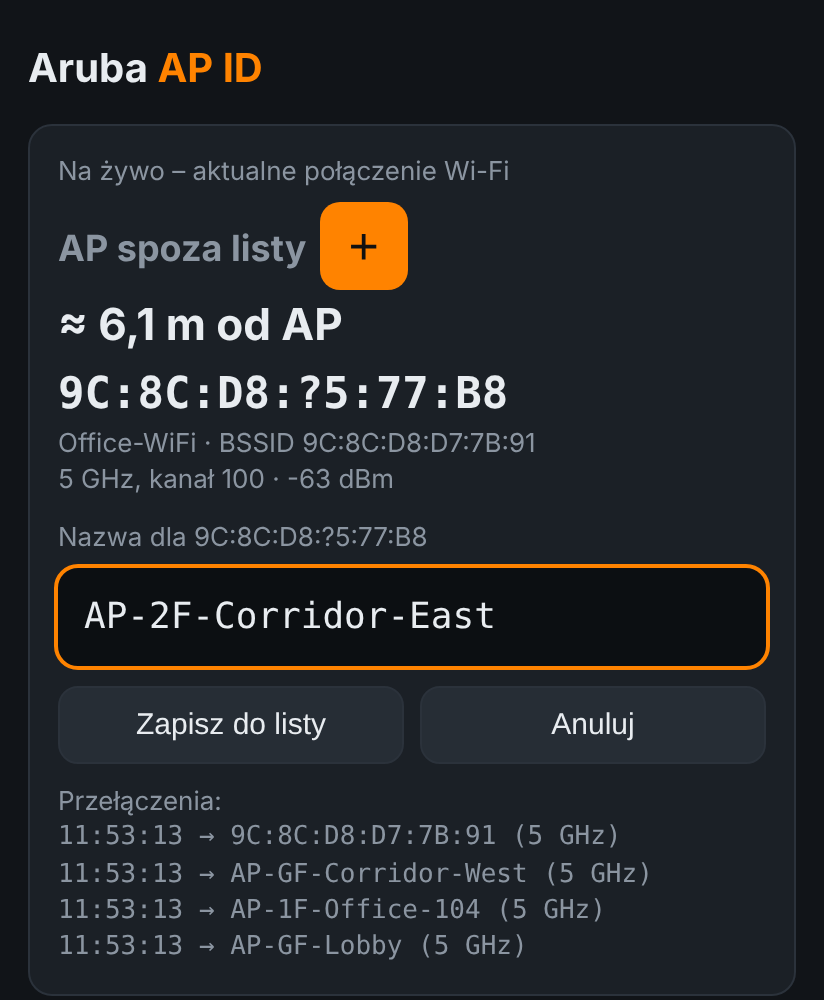
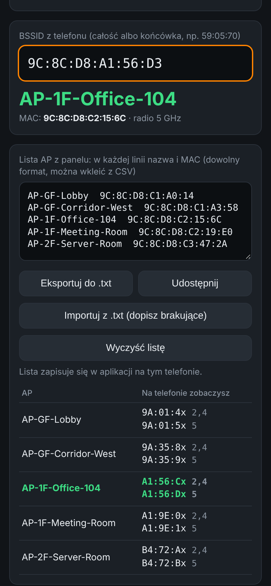

# Aruba AP ID

An Android app that shows **which physical Aruba access point your phone is connected to**, live, while you walk through the building. It reads the BSSID of the current Wi-Fi connection, converts it back to the AP's wired MAC address (the one shown in the Aruba controller / Central / Instant panel) and shows the AP name from your own list.

<p align="center">
  
  
  
</p>

## Why this exists

Every Aruba AP broadcasts several SSIDs on two radios, and each of them has its own BSSID. Wi-Fi apps show you those BSSIDs, but the management panel lists APs by their wired MAC address, so you can't tell which physical device you're on. When you're testing coverage or roaming between APs, you need to know that right away, not after converting MAC addresses in your head.

## Features

- **Live view**: reads the current BSSID, channel and signal strength every second and shows the AP name, its wired MAC and the band (2.4 / 5 GHz, detected from the frequency).
- **Roaming history**: logs every switch to another AP with a timestamp.
- **Distance estimate**: rough distance to the AP based on signal strength (same free-space formula most Wi-Fi apps use).
- **AP list**: paste names + MACs from the panel in any format (one AP per line, works with CSV exports).
- **Add unknown APs on the spot**: tap **+** next to an AP that's not on the list and give it a name.
- **Export / share / import**: save the list to `Download/` as a `.txt`, share it to another app, or import a friend's list. Import only adds missing APs and never overwrites yours.
- **Manual calculator**: type any BSSID (full or just the last 3 bytes) to get the AP MAC.
- Works offline. The app has no internet permission, so nothing ever leaves the phone.

## Download

Get the latest `.apk` from the [Releases](../../releases) page and install it on your phone (allow installing from unknown sources when Android asks).

> The APK is signed with a debug key, not published on Google Play. Play Protect may show a warning on first install, which you can safely skip.

## Requirements

- Android 5.0 or newer (export to `.txt` needs Android 10+, sharing works everywhere)
- **Location permission and location turned on**: Android hides the BSSID from apps without it. The app only uses it to read the Wi-Fi BSSID.
- Aruba APs (Instant or controller-based) on the 2.4 / 5 GHz bands

## How it works

According to Aruba's knowledge base, an AP derives its BSSIDs from its wired MAC address:

1. Drop the OUI (first 3 bytes) and the first hex digit of what's left: `CD:84:C8` → `D84C8`
2. XOR the first digit with `8`: `D` → `5`
3. Next digit: the last digit of the wired MAC on the **2.4 GHz** radio, that digit **+1** on the **5 GHz** radio
4. Last digit: SSID number on that radio (`0`–`F`)

```
wired MAC   9C:8C:D8:CD:84:C8
2.4 GHz  →  9C:8C:D8:58:4C:8x
5 GHz    →  9C:8C:D8:58:4C:9x
```

The app runs this backwards. The first digit of the 4th byte of the MAC never makes it into the BSSID, so without a list the app shows it as `?`. Matching against your AP list ignores that digit, so the AP is still identified exactly.

6 GHz radios and a few older models (e.g. AP-205H) use a different scheme and aren't supported.

## AP list format

One AP per line, name and MAC in any order and any separator:

```
AP-GF-Lobby  9C:8C:D8:C1:A0:14
AP-1F-Office-104;9c-8c-d8-c2-15-6c
"AP-2F-Server-Room","9C8CD8C3472A"
```

A `?` in place of a digit is allowed (that's how APs added with **+** are saved), e.g. `9C:8C:D8:?D:84:C8`.

## Building from source

The app is a tiny WebView wrapper written in smali, with the whole UI in `proj/assets/index.html`. You need Java plus [apktool 2.10.0](https://github.com/iBotPeaches/Apktool/releases/tag/v2.10.0) and [uber-apk-signer](https://github.com/patrickfav/uber-apk-signer/releases) next to the `proj` folder:

```powershell
java -jar apktool_2.10.0.jar b proj -o bssid-unsigned.apk; java -jar uber-apk-signer-1.3.0.jar -a bssid-unsigned.apk
```

Output: `bssid-aligned-debugSigned.apk`. apktool 3.x uses a different `apktool.yml` format and won't build this project as is.

## Limitations

- The distance is only an estimate. Walls, doors and people can easily double it. It's good for telling whether you're getting closer or further away.
- Aruba APs only, because other vendors derive BSSIDs differently.

## License

MIT, do whatever you want with it.

## Author

Made by [IT Guy](https://www.facebook.com/ajtiguy)
