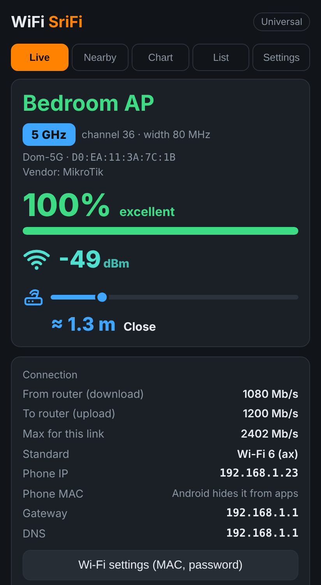
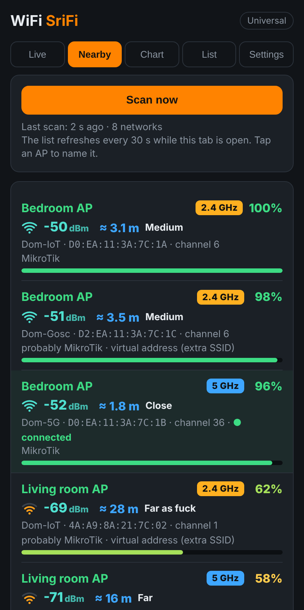
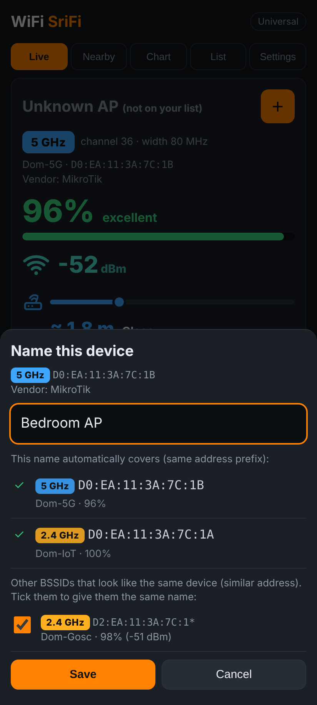
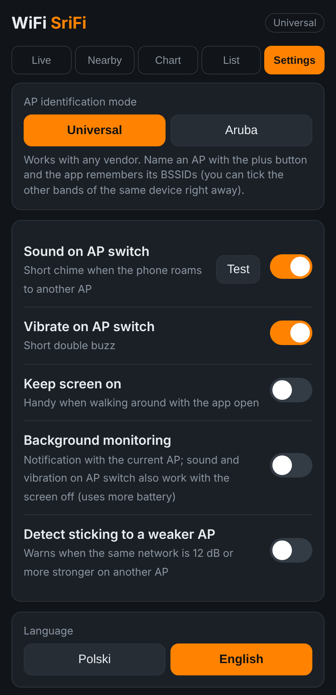

# WiFi SriFi

An Android app that shows **which access point your phone is connected to**, live, while you walk around. Name your APs once and the app tells you which one you're on, on which band (2.4 / 5 / 6 GHz), how strong the signal is and how fast the link is. It works with any vendor. For **Aruba** there's an extra mode that converts the BSSID back to the AP's wired MAC address from the controller / Central / Instant panel.

<p align="center">
  
  
  
  
</p>

## Why this exists

Every AP broadcasts several SSIDs on two or three radios, and each one has its own BSSID. Wi-Fi apps show you those BSSIDs, but not which physical device they belong to. When you're testing coverage or roaming, you need to know that right away.

## Features

- **Live view** (refreshes every second): AP name, a clear **band badge** (2.4 / 5 / 6 GHz), channel and width, SSID, BSSID and vendor.
- **Signal in % and dBm**: e.g. `58 % · good · −71 dBm`, with a coloured bar and a rough distance estimate.
- **Link details**: rate **from the router** and **to the router**, max rate for the link, Wi-Fi standard (4/5/6/6E/7), IP, gateway, DNS.
- **Rate-lock warning**: if the signal is good but the router keeps sending far below what the link allows (e.g. 20 Mb/s on a 1200 Mb/s link) for over 10 s, the app tells you. Some routers' drivers get stuck at the minimum rate after roaming, and reconnecting fixes it.
- **Roaming alerts**: a built-in sound and/or vibration when the phone switches AP (each can be turned off), plus a roaming history.
- **Background monitoring** (optional): a notification with the current AP, band and signal, and the roaming alerts keep working with the screen off.
- **Sticky-client detection** (optional): warns when the same network is 12 dB or more stronger on another AP while the phone stays on the weaker one.
- **Quick Settings tile**: the current AP name, band and signal in the pull-down panel.
- **Channel usage**: how many networks sit on each 2.4 / 5 / 6 GHz channel and how strong the loudest one is.
- **Nearby**: every AP in range with band, signal % and vendor, refreshed every 30 s. Tap one to name it.
- **Chart**: signal over the last 5 minutes, coloured per AP, with a marker at every switch.
- **Keep screen on** option for walk-through tests.
- **Export / share / import** of your AP list (import only adds the missing ones).
- **Polish and English**.
- Works offline. The app has **no internet permission**, so nothing ever leaves the phone.

## Two modes

### Universal (default) – any vendor

Tap **+** next to an unknown AP and give it a name. The app saves the BSSID prefix without its last digit (e.g. `D0:EA:11:3A:7C:1*`), so every SSID on that radio gets the name. The naming dialog also lists other BSSIDs from the last scan that look like the same device: same address apart from the first and last byte (other radio, virtual SSIDs). Tick them and one name covers every band, while the band badge still shows which one you're on.

### Aruba

Aruba APs derive their BSSIDs from the wired MAC, so the app can calculate the MAC you see in the panel. One entry (`AP name  wired MAC`) covers every band and every SSID of that AP.

According to Aruba's knowledge base:

1. Drop the OUI (first 3 bytes) and the first hex digit of what's left: `A1:B2:C8` → `1B2C8`
2. XOR the first digit with `8`: `1` → `9`
3. Next digit: the last digit of the wired MAC on the **2.4 GHz** radio, that digit **+1** on the **5 GHz** radio
4. Last digit: SSID number on that radio

```
wired MAC   9C:8C:D8:A1:B2:C8
2.4 GHz  →  9C:8C:D8:9B:2C:8x
5 GHz    →  9C:8C:D8:9B:2C:9x
```

The first digit of the 4th byte never makes it into the BSSID, so APs added with **+** in this mode are saved with a `?` there (e.g. `9C:8C:D8:?1:B2:C8`). Matching ignores that digit. 6 GHz radios and a few older models (e.g. AP-205H) use a different scheme. For those, use universal naming.

## AP list format

One AP per line, name and address, any separator:

```
Bedroom AP      D0:EA:11:3A:7C:1*      ← every BSSID starting with this (one radio)
Office 1F       9C:8C:D8:A6:E4:16      ← Aruba wired MAC (or an exact BSSID)
AP-2F-East;9c-8c-d8-?5-77-b8           ← "?" = unknown digit
```

## Download

Get the latest `.apk` from [Releases](../../releases) and install it (allow installing from unknown sources when Android asks).

## Requirements

- Android 7.0 or newer (the link details need Android 10–11+, saving `.txt` needs Android 10+)
- **Location permission and location turned on**: Android hides the BSSID from apps without them. The app uses them only to read Wi-Fi info.
- Android allows about **4 Wi-Fi scans per 2 minutes**, so the Nearby list can be up to a couple of minutes old. The live view isn't limited.

## Building from source

Plain Java + a WebView UI (`app/src/main/assets/index.html`), no external libraries.

1. Open the folder in **Android Studio** and wait for the Gradle sync.
2. **Build → Generate Signed App Bundle or APK → APK**, create a keystore (keep it outside the repo), choose `release`.
3. Output: `app/release/app-release.apk`.

The vendor table (`assets/oui.js`) is generated from the IEEE OUI registry via the [oui-data](https://www.npmjs.com/package/oui-data) package.

## License

MIT

## Author

Made by [IT Guy](https://www.facebook.com/ajtiguy)
